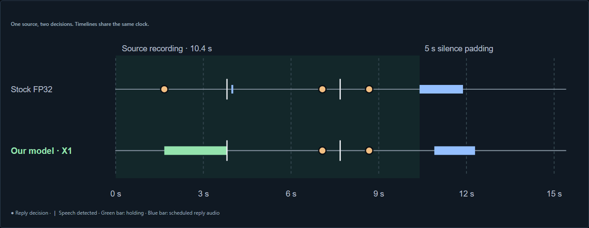

<div align="center">

<a href="https://64-177-51-1.sslip.io/"></a>

### Let people finish.

More patient voice AI, with turn-taking comparisons you can hear and inspect.

**[Website](https://64-177-51-1.sslip.io/) · [Judge guide](https://64-177-51-1.sslip.io/judge/) · [Live demo](https://64-177-51-1.sslip.io/live/) · [Devpost](https://devpost.com/software/stutterturn)**

Built at **Hacklanta '26** · **AI/ML track**

</div>

## A pause is not always the end of a thought

For someone who stutters, a pause can mean they are still working through a word. A voice assistant can mistake that pause for a finished turn and start answering too soon.

**StutterTurn explores how to give people room to finish.** We adapted an open turn-taking model and built a hosted voice agent that compares our X1 candidate with stock configurations on the same recorded speech. You can hear the interaction and see when the agent decides, waits, speaks, or cancels a reply.

## Hear the difference

1. **[Start with the judge guide](https://64-177-51-1.sslip.io/judge/#long-replay).** Inspect Stock FP32 and X1 on the same 10.4-second recording.
2. **Choose “Hear our model” or “Hear Stock FP32.”** Sign in with the supplied judge credentials; the console preselects the recording and configuration.
3. **Click Start.** Hear the recording and generated reply while events appear. Let the run finish before comparing the other configuration.

The console connects automatically to our Vultr backend. It offers model, recording, and voice selection, plus volume, Stop, and Reset. The public judge guide needs no login. The interactive demo uses recorded speech with fresh inference and generated replies; microphone input is future work.

[](https://64-177-51-1.sslip.io/judge/#long-replay)

*Captured from the hosted judge guide. Green marks a held pause; orange marks a reply decision; blue marks scheduled reply audio.*

## What the replay shows

At the early pause, **stock decided to answer; X1 kept listening.** The speaker resumed, and stock reported a brief reply-audio overlap. X1 reported none.

| Selected longer replay | Stock FP32 | Our X1 configuration |
|---|---|---|
| Decision at 1.664 s | Reply | Hold |
| Reported audio overlap | 0.050 s | None |
| Generated reply | Completed | Completed |

The guide also includes **five additional Stock FP32/X1 pairs**. All **12 selected runs** rendered source and generated speech in Chromium. [Inspect the longer pair](agent/evidence/2026-10-11-long-replay-working/README.md) or [the five additional pairs](agent/evidence/2026-10-11-model-five-replay/README.md).

These are selected replay observations, not a general interruption rate. Both configurations use a 0.2-second silence gate, with different weights and thresholds (stock 0.5; X1 0.6). Audio timing comes from the server schedule. X1 is exploratory and was chosen using reused development data; broader evaluation must measure response delay as well as interruptions. Its five short replays first completed through the three-second silence fallback.

## Four integrations, one working voice agent

| Technology | What it does in StutterTurn |
|---|---|
| **Google Gemini API** | Receives captured speech and generates a brief contextual reply once the turn policy decides to answer. |
| **ElevenLabs** | Generates streaming speech delivered to the browser, with playback cancellation when the speaker resumes. |
| **Tiger Data** | Stores timestamped run events and uses SQL to reconstruct decisions, resumed speech, cancellations, and response timing. |
| **Vultr** | Runs ONNX inference, the Python agent, provider requests, and the authenticated HTTP/WebSocket API alongside the HTTPS site. |

Silero VAD tracks speech activity. Smart Turn or X1 decides when to respond. Gemini generates the reply, ElevenLabs voices it, and Web Audio plays the streamed PCM in the browser. Resumed speech can cancel a pending or active reply.

Tiger Data holds **37 runs and 631 events**, including earlier attempts. The judge charts are saved SQL exports checked against the original logs; ingestion is explicit. [Sponsor details](docs/sponsors.md) · [Database queries](web/tiger/README.md) · [Cloud deployment](docs/vultr-backend.md)

## What we built

- **Model adaptation:** recovered Smart Turn v3.2 FP32 weights into PyTorch, trained experimental candidates, and exported back to ONNX with verified reconstruction/export mechanics.
- **An audible comparison console:** browser playback, configurable replays, live events, and cancellation across the response pipeline.
- **Traceable evaluation:** model identities, source recordings, run logs, and database queries tied to the displayed comparisons.

[Model results](docs/model-results-2026-10-10.md) · [Model mechanics](docs/proofs/model-mechanics/README.md) · [Hosted verification](docs/proofs/long-replay-judge/README.md)

## Run it yourself

See the **[agent setup guide](agent/README.md)** for Python dependencies, model/audio downloads, and Gemini/ElevenLabs configuration. Candidate runs require the X1 ONNX artifact and matching metadata. Keep API keys in the ignored local environment file.

From the repository root, with the agent environment configured, run these in separate terminals:

```bash
# Frontend: http://127.0.0.1:8041/live/
python -m http.server 8041 --bind 127.0.0.1 --directory web
```

```bash
# Local backend; --play uses this machine's speakers
python agent/server.py --play
```

For hosted browser audio, follow the [Vultr deployment guide](docs/vultr-backend.md).

<details>
<summary><strong>Tests and supporting records</strong></summary>

47 backend tests passed locally and on Vultr. Browser checks cover audio sequencing, cancellation, stale messages, authentication, and source/model selection. Earlier provider failures remain in the evidence archive; successful selected runs do not guarantee future API availability.

```bash
python -m unittest discover -s agent/tests -q
python -m unittest discover -s web/tiger -p test_comparison.py -q
```

[Playback and deployment proof](docs/proofs/long-replay-judge/README.md) · [Provider recovery](docs/proofs/gemini-empty-recovery/README.md) · [Historical Stock/Patient baseline](agent/evidence/2026-10-10-replay-v2/README.md) · [Original benchmark](benchmark/RESULTS.md)

</details>

## Next: validate the conversation

Our next milestone is a human-reviewed confirmation set that measures premature replies, completed-turn response delay, cancellations, and nonresponses together. We also plan to automate cloud-run ingestion and explore microphone and telephone input with people who stutter.

## Team and credits

Built by **Vinh, Guttuu, Niko, and Kareem** for Hacklanta '26.

We build on **Pipecat Smart Turn, Whisper, Silero VAD, haan, and SEP-28k**, with credit to their creators and the original podcast speakers. Our examples use real recordings; nobody imitates stuttering. Dataset, audio, and model release terms remain separate.

Concept research and planning preceded the event. The team changed direction to StutterTurn on Saturday morning; benchmark development and implementation followed during the event. Claude Code and Codex assisted with implementation, documentation, and review.
